Campaign `20261013T090846-615f4357f015-all`, measured at commit `615f435`. Every number below is
the **median of 5 independent processes, with [min–max]** where given, and comes from a file
under `results/part_d/`; the complete tables are `results/part_d/summary/summary.md` and the
CSVs next to it. Nothing was estimated and no run was dropped. 300 measured runs, 0 failures,
0 problems found by the completeness check.

# 1. Environment and method

**Machine.** AMD Ryzen AI 7 350, 8 cores / 16 logical CPUs (cores 0, 2, 4, 6 reach 5.09 GHz;
cores 1, 3, 5, 7 reach 3.51 GHz; CPU *N*+8 is the SMT sibling of *N*), L3 16 MiB, 30 GiB RAM.
Ubuntu 26.04, Linux 7.0.0-28, GCC 15.2.0, Release build `-O3 -g -DNDEBUG -std=c++17
-fno-omit-frame-pointer`. Mains power, `performance` governor and EPP on all CPUs at each of 56
checkpoints (start, after every repetition, end); `kernel.perf_event_paranoid = 1`. The machine
was 99 % idle when the campaign started. The battery was charging throughout and the ACPI
temperature rose from 44 to 86 °C; the min–max ranges below are narrow, so no drift is visible,
but thermal limiting cannot be excluded (`results/part_d/conditions.log`).

**Placement.** Reader (or joiner) thread *i* is pinned to the *i*-th of CPUs 0, 2, 4, 6, 1, 3,
5, 7: one logical CPU per physical core, fast cores first. The writer is pinned to CPU 15. The
store's cleaner thread is not pinned (the store has no interface for it).

**Two tracks, never in one table or figure.**

- **Track R — supplied generator, preload-only.** The four drivers linked with the unmodified
  `supplied/workload_gen.cpp`, default parameters. Its writer loads all trades and *finishes
  before any reader starts*: there is no writer in these numbers. 20 % of its reads use
  `rng() % (m·n)` while trade ids are `i·100000 + j`, so only 100 of those 100,000 possible keys
  exist: measured hit rate **80.02 %**.
- **Track C — writer active.** `benchmarks/concurrent_bench.cpp`: the same schema, hot set and
  80/20 mix, every requested key present, and one writer thread overwriting existing trades
  for the whole measured window (0.5 s warm-up, 5 s measured). Every read is validated; the
  writer's successful updates are counted. Two writer modes: paced at 10,000 updates/s, and
  unthrottled.

D.1 asks for the generator "with one background writer thread active throughout". The supplied
generator cannot do that, so both tracks are reported and labelled.

**Caveats that apply to all throughput numbers.** Both harnesses time every `get` with two
clock reads; in the profile of the RCU store with no writer those clock reads are 33 % of all
cycles (`summary/profile_breakdown.txt`). The numbers are therefore lower bounds on what the
stores can do, equally for all four. The generator prints latencies with one decimal of a
microsecond.

**Comparing RCU with the lock variants** compares two whole designs. The Part A stores update
one slot in place under a lock; the RCU store copies the 24 KiB segment it touches and a 2 KiB
directory for every update and reclaims the old ones later. The difference between them is not
the cost of a synchronization primitive alone.

# 2. D.1 — point-query throughput and the 100,000 RPS target

## 2.1 Track C: one writer active throughout

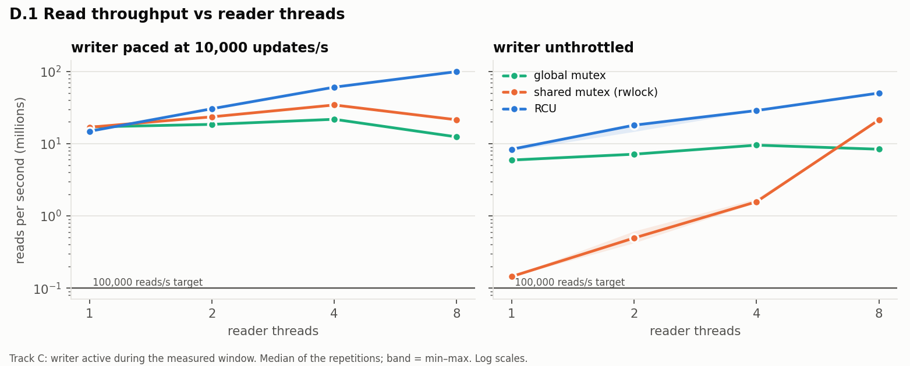{width=100%}

**Reads per second (millions), median [min–max]:**

| Readers | global mutex, paced | shared mutex, paced | RCU, paced | global mutex, unthrottled | shared mutex, unthrottled | RCU, unthrottled |
|---:|---:|---:|---:|---:|---:|---:|
| 1 | 17.00 [16.98–17.20] | 16.86 [16.78–16.87] | 14.81 [14.77–14.92] | 5.93 [5.65–6.16] | 0.14 [0.14–0.15] | 8.36 [7.96–8.87] |
| 2 | 18.47 [18.08–18.85] | 23.49 [23.18–23.90] | 30.39 [30.28–30.55] | 7.14 [7.12–7.40] | 0.49 [0.42–0.61] | 18.00 [14.66–18.02] |
| 4 | 21.73 [20.98–22.15] | 34.28 [34.14–34.42] | 60.44 [60.23–60.79] | 9.53 [9.45–9.59] | 1.57 [1.52–1.73] | 28.69 [28.55–28.90] |
| 8 | 12.39 [12.35–12.46] | 21.37 [21.15–21.67] | **99.25 [98.81–99.54]** | 8.37 [8.24–8.45] | 21.30 [21.09–21.42] | **50.09 [49.93–50.47]** |

**Read latency at 8 readers (µs):**

| Store, writer | p50 | p99 | p99.9 | max, median run / worst run |
|---|---:|---:|---:|---:|
| global mutex, paced | 0.110 | 7.616 | 13.824 | 166 / 992 |
| shared mutex, paced | 0.371 | 0.721 | 1.408 | 906 / 4,095 |
| RCU, paced | 0.050 | 0.141 | 0.210 | 87 / 143 |
| global mutex, unthrottled | 0.170 | 9.472 | 16.384 | 299 / 313 |
| shared mutex, unthrottled | 0.391 | 0.721 | 1.376 | 896 / 3,024 |
| RCU, unthrottled | 0.120 | 0.390 | 0.561 | 74 / 142 |

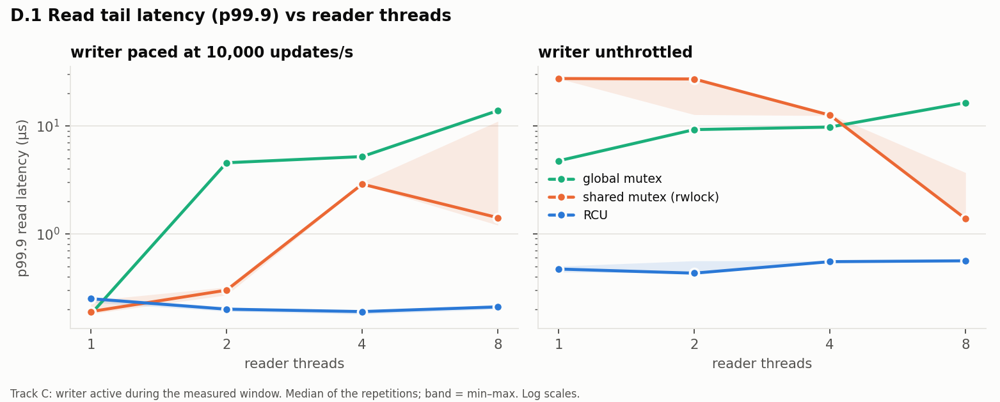{width=100%}

**Successful writer updates per second:**

| Readers | global mutex, paced | shared mutex, paced | RCU, paced | global mutex, unthrottled | shared mutex, unthrottled | RCU, unthrottled |
|---:|---:|---:|---:|---:|---:|---:|
| 1 | 10,000 | 10,000 | 10,000 | 2,976,055 | 144,543 | 167,456 |
| 2 | 10,000 | 10,000 | 10,000 | 2,237,224 | 139,935 | 164,321 |
| 4 | 10,000 | 10,000 | 10,000 | 1,742,449 | 130,062 | 108,738 |
| 8 | 10,000 | **1,582 [890–6,351]** | 10,000 | 633,443 | **1,500 [1,382–1,955]** | 101,121 |

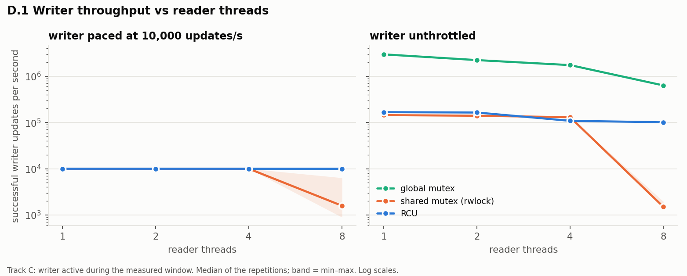{width=100%}

One thread only: the unsynchronized store reads 19.12 M/s alone and 18.21 M/s while doing one
update per 100 reads on the same thread; it is never run with concurrent threads. The RCU
store with no writer reads 16.67 M/s on one thread and 112.26 M/s on eight.

With the generator's own key distribution *and* a paced writer (8 readers): global mutex
13.40 M lookups/s, shared mutex 22.47 M, RCU 105.27 M, each with an 80.02 % hit rate
(successful reads 10.72 / 17.98 / 84.24 M/s).

## 2.2 Where the lock-based stores stop scaling

- **Global mutex: after 4 readers.** Throughput rises from 17.0 to 21.7 M/s at 4 readers and
  *falls* to 12.4 M/s at 8 (paced writer); with the unthrottled writer 5.9 → 9.5 → 8.4 M/s. At 8
  readers with the unthrottled writer the process makes 3.7 million context switches in a
  5.5 s run (2.6 million with the paced one), 77 % of sampled on-CPU cycles are in the kernel
  (futex wait and wake) and another 13 % in the mutex functions; only 1.4 % are in the lookup
  itself (`perf/flamegraphs/global_lock_r8_writer_max.svg`).
  Readers serialize on one lock and spend their time handing it over. p99 read latency grows
  from 0.07 µs at 1 reader to 7.6 µs at 8.
- **Shared mutex: after 4 readers with a paced writer** (16.9 → 23.5 → 34.3 → 21.4 M/s). Readers
  do not exclude each other, but every `get` writes the lock's reader count twice. At 8 readers
  66 % of on-CPU cycles are in `pthread_rwlock_rdlock`/`unlock`, and `perf c2c` puts 67 % of all
  loads that hit a line modified by another core on **one cache line**, the lock itself
  (`perf/c2c/rwlock_r8_writer_max.c2c-report.txt`). **It also starves the writer:** asked for
  10,000 updates/s it completes 1,582 at 8 readers, and unthrottled only 1,500.
  With an unthrottled writer and few readers the opposite happens: the writer holds the lock
  and reads collapse to 0.14 M/s at 1 reader; the "scaling" from 1.6 to 21.3 M/s between 4 and
  8 readers is the readers taking the lock away from the writer, not parallel speed-up.
- **RCU: still rising at 8 readers** in both writer modes: 14.8 → 30.4 → 60.4 → 99.3 M/s paced
  (6.7× from 1 to 8 readers; the last four readers run on the slower cores and one shares its
  core with the writer), 8.4 → 18.0 → 28.7 → 50.1 M/s unthrottled.

## 2.3 The 100,000 reads/s target

| RCU store, 8 readers | Median reads/s | Minimum of 5 runs | 100,000/s |
|---|---:|---:|---|
| Track C, writer paced at 10,000/s | 99,249,401 | 98,806,210 | **met** |
| Track C, writer unthrottled (101,121 updates/s) | 50,088,105 | 49,934,831 | **met** |
| Track R, supplied generator (preload-only) | 84,185,176 lookups/s | 77,088,328 | **met** |

The target is met by a factor of about 500 to 1000 in every configuration measured, with
p99.9 read latency of 0.21 µs (paced writer) and 0.56 µs (unthrottled). Because it is met, the
assignment's fallback ("report the number you achieved and explain the remaining bottleneck,
backed by a flame graph") does not apply; the flame graphs were taken anyway and are used in
§2.5.

## 2.4 Track R — supplied generator, preload-only

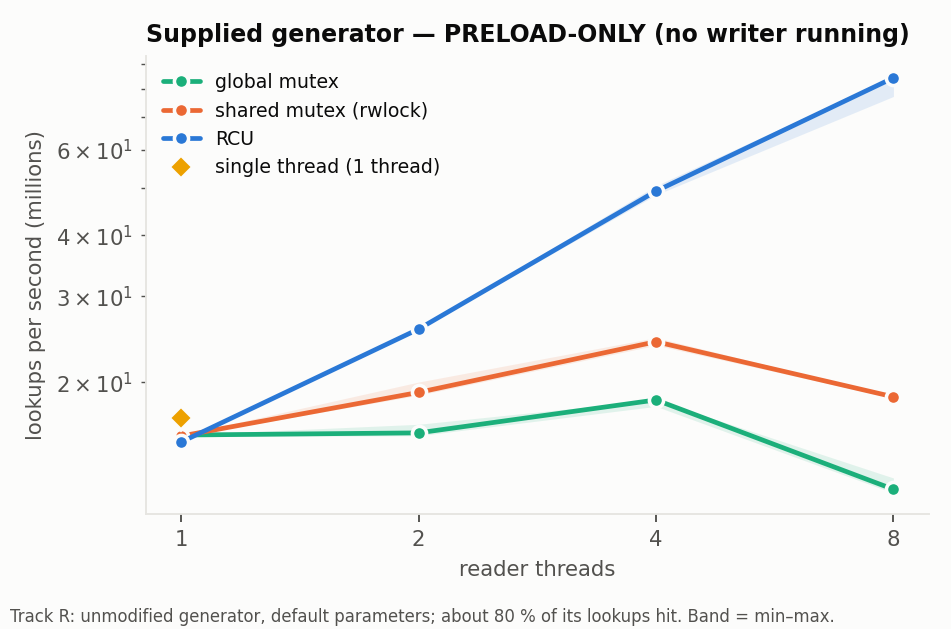{width=62%}

| Readers | single thread | global mutex | shared mutex | RCU |
|---:|---:|---:|---:|---:|
| 1 | 16.89 [16.80–16.95] | 15.58 [15.47–15.60] | 15.50 [15.46–15.57] | 15.07 [15.04–15.10] |
| 2 | — | 15.74 [15.53–16.39] | 19.05 [18.80–20.01] | 25.69 [25.66–25.77] |
| 4 | — | 18.39 [17.84–18.39] | 24.20 [23.81–24.68] | 49.29 [48.43–50.57] |
| 8 | — | 12.05 [11.84–12.72] | 18.66 [18.55–18.70] | 84.19 [77.09–84.65] |

Lookups per second (millions), **no writer running**, 80.02 % of lookups hit. The same shape as
track C: the mutex stores peak at 4 readers, RCU keeps rising. p99.9 at 8 readers as printed by
the generator: 7.7 µs (global mutex), 1.1 µs (shared mutex), 0.2 µs (RCU).

## 2.5 What RCU costs, and what limits it

**Memory and reclamation.** Every update copies 25,974 bytes (one 24 KiB segment and the 2 KiB
directory) for a 32-byte value. With the paced writer the store holds 11 MiB at the end of
every run and the backlog is empty. **With the unthrottled writer the cleaner does not keep
up beyond 2 readers:**

| Readers (unthrottled writer) | Memory held at end, MiB | Retired versions not yet reclaimed at end | Cleaner CPU, s of 5.5 |
|---:|---:|---:|---:|
| 1 | 31 [31–32] | 0 | 4.73 |
| 2 | 31 [31–98] | 0 | 4.87 |
| 4 | 655 [536–817] | 23,852 | 5.42 |
| 8 | 3,662 [3,326–4,813] | 138,157 | 5.22 |

The cleaner thread is fully busy at every reader count. At 8 readers the writer retires about
101,000 versions per second and the cleaner destroys about 87,000, so the backlog grows by
roughly 25,000 versions (0.65 GiB) per second for as long as the writer runs flat out. The
store has no back-pressure (a deliberate choice, decision D-040), so this ends only when the
writer slows down or memory runs out. It drains completely afterwards (validated in every
run). The audited Part B binary behaves the same when run alternately with the campaign's
binary (75,000–100,000 unreclaimed versions after 3.5 s for both; a diagnostic outside the
campaign, `results/part_d_diagnostics/part_b_reference_backlog.txt`), so it is not something
Part C introduced. **A sustained unthrottled writer with 8 readers is not a
steady state for this store on this machine.** The 10,000 updates/s workload is.

**Reads slow down by half next to an unthrottled writer** (99.3 → 50.1 M/s at 8 readers;
16.7 → 8.4 M/s for a single reader with idle cores all around it). What the evidence says:

- It is not lock or scheduler contention: readers take no lock, and the slowdown is uniform
  across reader threads (slowest/fastest 4.94/7.25 M/s against 11.48/16.58 M/s with no writer)
  and present with a single reader.
- The number of instructions per read hardly changes (447 → 541); cycles per read go from 335
  to 928 and instructions per cycle from 1.33 to 0.58. The readers are stalled, not doing more
  work.
- `perf c2c` (AMD IBS load sampling): of the loads with a known data source, those served from
  L3 rise from 1.2 % to 3.6 % and those that hit a line modified by another core from 0.5 % to
  2.9 %.
- **The hypothesis that writer-updated segment owner counts share cache lines with reader
  data (audit item R8) is only weakly supported.** Of 804 such "modified elsewhere" load
  samples at 8 readers, 58 % were taken by the writer's own commit and 24 % by the functions
  taking and releasing references (cleaner and writer): that is the writer and the cleaner contending
  with each other on owner and reference counts. **6.7 % (54 samples, on 46 different cache
  lines) were taken by the reader's lookup**, which is 0.07 % of all sampled loads. Readers do
  touch lines the writer or cleaner has just modified, but too rarely for that to explain a
  factor of two.
- What fits all of the above, without being proven by it: copy-on-write *relocates* what
  readers read. Each update publishes a new 24 KiB segment at a new address, so the copy of
  that partition a reader has in its own caches is useless and the next probe has to fetch
  lines from L3 or from the writer's core; at 100,000 updates/s that is 2.6 GB/s of freshly
  written index flowing through a 16 MiB shared L3 that also has to hold the readers' 9 MiB
  working set.
- The profile cannot separate this further. In the flame graph the reader threads' cycles
  shift from the lookup (64 % → 17 %) to the harness's clock reads (33 % → 49 %); a timestamp
  read waits for the loads before it, so stall time is charged to it. That shift is an
  artefact of attribution, not evidence that reading the clock became slower.

No optimization was attempted. A test that would decide it: per-thread hardware counters for
the reader threads alone, and the same workload against a store that updates in place.

perf stat for the three stores at 8 readers with the unthrottled writer: CPUs utilized 7.30 /
7.90 / 8.79 (global mutex / shared mutex / RCU: the RCU process also runs its cleaner),
context switches per second 674,661 / 13,805 / 27,545, peak resident memory 39 / 14 / 4,147 MiB.

# 3. D.2 — reclamation-batch tuning

`set_reclaim_batch(n)`: one reclamation pass frees at most *n* retired versions. Settings 1, 8,
64, 256, 1024; reclamation disabled; and the naive stop-the-world sweep (all readers frozen by a
lock, the whole retire list freed at once). RCU store, 8 readers, unthrottled writer, 3 s
windows (1 s with reclamation disabled, which retains everything). In every epoch-based run
the largest number of versions freed in one pass equalled the batch (1, 8, 64, 256, 1,024) and
never exceeded it.

Two workloads, **not comparable with each other**:

- **A, steady point gets:** the D.1 benchmark (100,000 trades of 32 bytes).
- **B, backlog-building:** `benchmarks/reclaim_bench.cpp`, 2,000 keys of 4 KiB, and a thread
  that holds a Snapshot for 20 ms out of every 50 ms. While it is held nothing retired after it
  can be freed, so thousands of versions accumulate and are released in passes. At the end the
  writer stops, the last snapshot is released, and the time to drain is measured with the
  readers still running.

## 3.1 Results

**Workload A:**

| Setting | Reads/s (M) | Longest single reader stall, µs: median run / worst run | p99.9 µs | Versions reclaimed/s | Backlog max | Memory at end, MiB | Passes |
|---|---:|---:|---:|---:|---:|---:|---:|
| batch 1 | 50.99 [50.53–51.14] | 227 / 388 | 0.551 | 81,672 | 113,162 | 2,989 | 245,037 |
| batch 8 | 50.38 [49.87–50.77] | 129 / 495 | 0.561 | 87,068 | 108,314 | 2,862 | 32,730 |
| batch 64 | 50.31 [50.12–50.52] | 56 / 683 | 0.561 | 87,419 | 109,026 | 2,878 | 4,193 |
| batch 256 | 50.63 [49.89–50.80] | 68 / 340 | 0.561 | 83,175 | 113,650 | 3,002 | 1,076 |
| batch 1024 | 50.01 [49.85–50.56] | 46 / 272 | 0.561 | 97,374 | 85,273 | 2,257 | 732 |
| disabled (1 s) | 73.97 [73.84–74.26] | 96 / 396 | 0.451 | 0 | 224,171 | 4,405 | — |
| stop-the-world | 4.62 [3.93–5.05] | **6,436 / 6,777** | 2.144 | 193,026 | 9,429 | 30 | — |

**Workload B:**

| Setting | Reads/s (M) | Longest single reader stall, µs: median run / worst run | p99.9 µs | Backlog max | Memory max, MiB | Final cleanup: backlog → ms to drain |
|---|---:|---:|---:|---:|---:|---:|
| batch 1 | 37.84 [37.66–40.57] | 235 / 430 | 0.481 | 8,230 | 83.7 | 8,133 → 29.9 |
| batch 8 | 40.30 [37.36–40.59] | 275 / 550 | 0.481 | 5,730 | 66.7 | 5,760 → 18.1 |
| batch 64 | 40.21 [40.10–40.41] | 289 / 518 | 0.481 | 5,522 | 64.6 | 5,553 → 18.4 |
| batch 256 | 40.20 [37.19–40.35] | 203 / 406 | 0.481 | 5,691 | 65.3 | 5,734 → 15.3 |
| batch 1024 | 40.22 [40.07–40.34] | 188 / 278 | 0.481 | 5,540 | 65.0 | 5,553 → 14.6 |
| disabled (1 s) | 43.09 [42.94–43.17] | 54 / 62 | 0.451 | 250,128 | 1,725 | — |
| stop-the-world | 3.42 [3.26–3.46] | **25,061 / 26,578** | 10.112 | 10,406 | 97.7 | 10,447 → 15.7 |

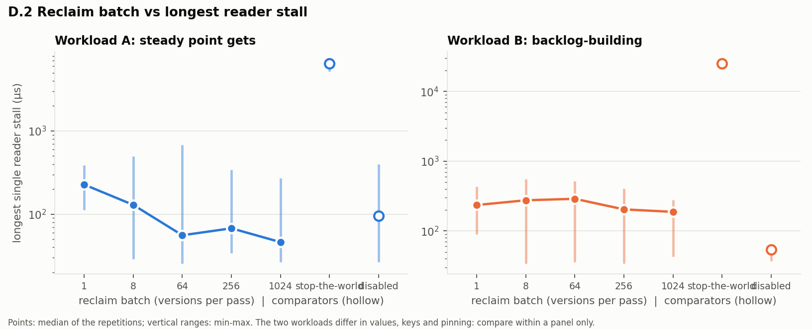{width=100%}

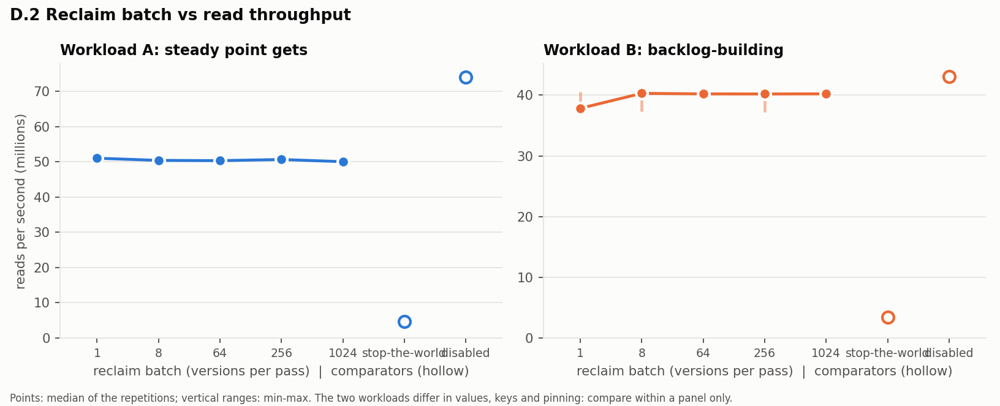{width=100%}

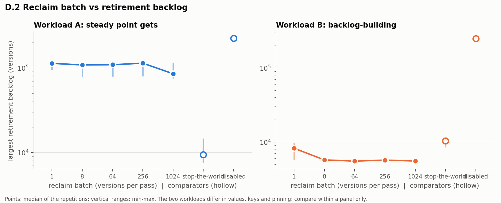{width=100%}

## 3.2 What the batch size trades off here

The assignment expects "a bigger batch should mean higher throughput but a longer worst-case
stall". **That is not what was measured**, in either workload:

- **Read throughput does not depend on the batch.** 50.0–51.0 M/s in workload A and
  37.8–40.3 M/s in workload B across a thousandfold range of batch sizes, with p99.9 identical
  to three digits. The cleaner works on its own thread and takes no lock a reader takes, so
  how it groups its work is invisible to `get`.
- **The longest reader stall does not grow with the batch.** Medians of 227, 129, 56, 68 and
  46 µs for batches 1 to 1024 in workload A, and 235, 275, 289, 203, 188 µs in workload B; the
  worst single run was at batch 64 and batch 8 respectively. These maxima are single events in
  about 150 million reads. With reclamation **disabled** the longest stall is of the same
  order (96 µs median, 396 µs worst run in workload A), so the stalls that occur are not
  caused by reclamation passes; with no writer at all the maximum is 25 µs (85 µs worst run).
  There is no evidence that a reclamation pass stalls a reader, at any batch size.
- **What the batch does change is how fast versions are reclaimed, i.e. memory.** A pass has a
  fixed overhead (one attempt to advance the epoch, a scan of the reader slots), so one
  version per pass is the least efficient: in workload B, batch 1 leaves a backlog about 45 %
  larger (8,230 against about 5,600 versions), 28 % more memory, and takes twice as long to drain
  (29.9 ms against 14.6 ms). In workload A, where the cleaner is the bottleneck, batch 1024
  reclaims 97,374 versions/s against 81,672 for batch 1 and ends with 25 % less memory.
  Between 8 and 256 the differences are within the run-to-run range.

So for this design the tunable trades **reclamation throughput and memory** against the
granularity of the cleaner's work, not reader throughput against reader pauses. A larger batch
is better or equal on every measure taken here; the reason to keep it bounded is that a pass
is the unit in which the cleaner re-checks the epoch, and the bound is what makes its work
between two checks finite.

## 3.3 The two reference points

- **Reclamation disabled** reads fastest (74.0 M/s in workload A against about 50) because
  nothing is being freed: no cleaner competing for a core and for the allocator. It retained
  4.4 GiB in 1.5 s in workload A and 1.7 GiB in workload B. It is not a usable configuration.
- **Stop-the-world** is the fastest way to free memory (193,026 versions/s; 30 MiB held where
  the epoch-based runs hold 2–3 GiB) and lets the writer run faster (160,704 against about
  101,000 updates/s), because the sweep has no batch limit and nothing else runs meanwhile.
  It pays with the readers: **read throughput falls to 4.6 M/s (one eleventh) and the longest
  reader stall rises to 6.4 ms in workload A and 25.1 ms in workload B.**

**Bounded reclamation against stop-the-world, worst reader pause** (median of the longest
stall; the epoch figure is the worst batch size):

| Workload | Stop-the-world | Epoch-based (worst batch) | Reduction |
|---|---:|---:|---:|
| A, steady | 6,436 µs | 227 µs | 28× |
| B, backlog-building | 25,061 µs | 289 µs | 87× |

# 4. D.3 — join and multi-key writes

## 4.1 Index-nested-loop join, writer active and paused

The join of Part C.2 (`benchmarks/join.h`): for every key that `keys()` returns for the Trades
table, fetch the trade, probe the Instruments table's secondary index with its symbol, and
fetch every matching instrument. 100,000 trades, 50 instruments, 100,000 joined rows per join;
every join is validated (complete; pairs match; the inner table of one version).

**Snapshots: one per store.** The join takes one Snapshot of Trades and one of Instruments at
its start and uses each for every call on its own store. Each table is read from one
immutable version for the whole join; the two versions are not guaranteed to be one atomic
instant; and it is two handles, not the "exactly one Snapshot handle" of the assignment's
wording (a recorded deviation, decision D-060).

When active, the writer issues single Trade puts that change the trade's symbol and, after
every 64 of them, one transaction rewriting all 50 instruments.

| Joiners | Writer | Joins/s | Joined rows/s (M) | p50 ms | p99 ms | p99.9 ms | max ms, worst run | Memory max, MiB | Backlog max |
|---:|---|---:|---:|---:|---:|---:|---:|---:|---:|
| 1 | paused | 159.0 [157.2–160.2] | 15.90 | 6.26 | 6.65 | 11.31 | 11.80 | 9.1 | 0 |
| 1 | active | 65.6 [65.1–65.9] | 6.56 | 15.12 | 16.46 | 16.75 | 16.87 | 149.1 | 5,431 |
| 2 | paused | 307.8 [304.1–311.0] | 30.78 | 6.48 | 6.89 | 10.45 | 11.02 | 9.1 | 0 |
| 2 | active | 153.6 [150.4–154.9] | 15.36 | 12.86 | 14.45 | 14.63 | 14.72 | 129.8 | 4,630 |
| 4 | paused | 588.7 [584.0–598.6] | 58.87 | 6.78 | 7.12 | 10.57 | 10.64 | 9.1 | 0 |
| 4 | active | 297.8 [289.2–303.9] | 29.78 | 13.26 | 15.00 | 15.15 | 16.14 | 127.7 | 4,547 |
| **8** | **paused** | **1,026 [1,003–1,036]** | 102.62 | **7.14** | 9.34 | 11.61 | 12.88 | 9.1 | 0 |
| **8** | **active** | **580.3 [576.1–608.0]** | 58.03 | **13.15** | 21.12 | 24.08 | 24.64 | 446.6 | 16,926 |

Writer while the joins ran: 163,318 Trade puts/s and 2,552 Instrument transactions/s with one
joiner; 108,352 and 1,693 with eight.

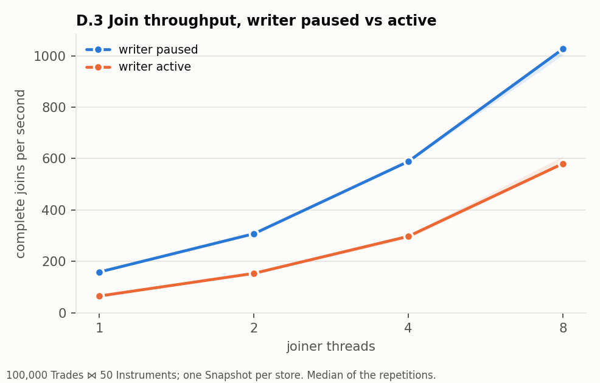{width=49%} 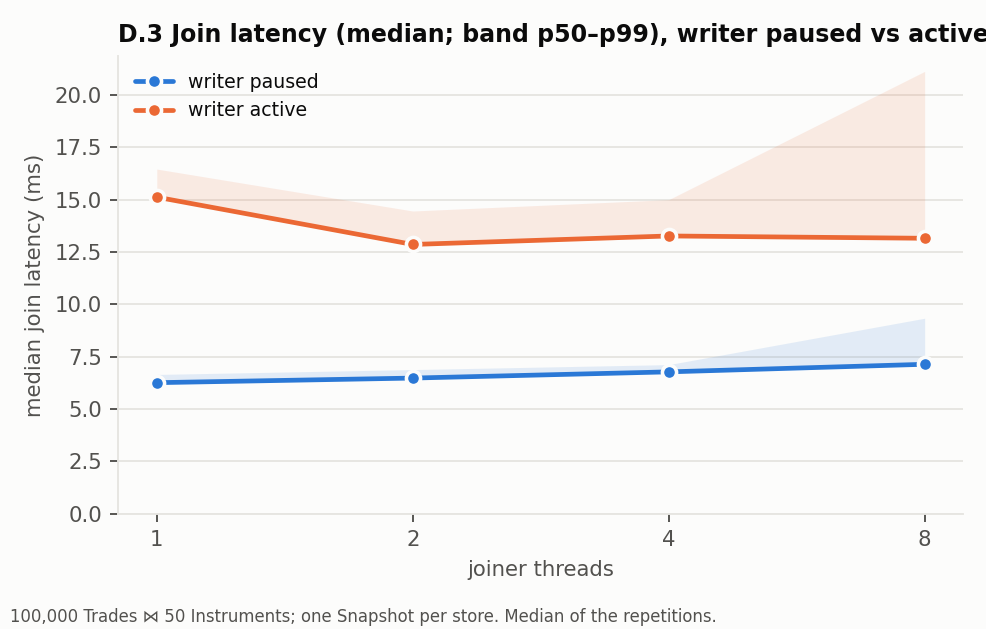{width=49%}

**What the concurrent writer costs a join.** At 8 joiners: 1.84× the median latency (7.14 →
13.15 ms), 2.3× the p99 (9.34 → 21.12 ms) and 43 % of the throughput (1,026 → 580 joins/s). The
same factor of about two as for point reads next to an unthrottled writer (§2.5), and for the
same reason: the join never waits for the writer, but the rows and index segments it reads
keep being republished at new addresses. A join is never blocked and never returns a wrong or
partial result in either mode.

**Joins hold reclamation back.** A join pins both stores for its 7–25 ms, so everything
retired meanwhile waits: up to 447 MiB held and 16,926 unreclaimed versions with 8 joiners and
the writer active, against 9.1 MiB with the writer paused. All of it is reclaimed when the
joins end.

**The generator's `use_join` path is not this join.** It follows each successful `get` with
one `index_get` on the Instruments store and discards the result. On the RCU store, 8 readers,
preload-only: 61.30 M operations/s against 81.48 M without the probe. Its probe passes an
eighth symbol byte that the generator never writes; in these binaries that byte was 0 in all
100,000 stored trades and the probe matched **100 %** (measured from the store after each run).

## 4.2 Transaction commit throughput by size

One writer committing transactions of *N* Trades into the 100,000-row table, keys spread over
the table (so *N* keys fall into *N* different hash partitions almost always). "No index" is
the Trades table as the assignment loads it; "indexed" adds a secondary index on the field
every write changes, the worst case for index maintenance.

| Keys | Index | Commits/s | Rows/s | p50 µs | p99 µs | p99.9 µs | max µs, worst | Segments cloned per commit | Bytes copied per commit | Bytes copied per row |
|---:|---|---:|---:|---:|---:|---:|---:|---:|---:|---:|
| 1 | none | 238,103 [229,076–240,839] | 238,103 | 3.7 | 8.7 | 12.0 | 165 | 1.00 | 26,102 | 26,102 |
| 4 | none | 101,298 [96,078–104,522] | 405,192 | 9.2 | 18.6 | 24.2 | 103 | 3.98 | 97,729 | 24,432 |
| 16 | none | 26,655 [26,286–26,867] | 426,486 | 37.5 | 69.4 | 83.8 | 145 | 15.55 | 376,025 | 23,502 |
| 1 | indexed | 58,824 [58,446–59,059] | 58,824 | 16.3 | 29.6 | 34.9 | 90 | 1.00 | 140,817 | 140,817 |
| 4 | indexed | 17,555 [17,304–17,584] | 70,219 | 57.0 | 76.2 | 85.8 | 380 | 3.98 | 523,721 | 130,930 |
| 16 | indexed | 6,134 [5,918–6,220] | 98,150 | 161.6 | 207.8 | 232.1 | 338 | 15.55 | 1,472,800 | 92,050 |

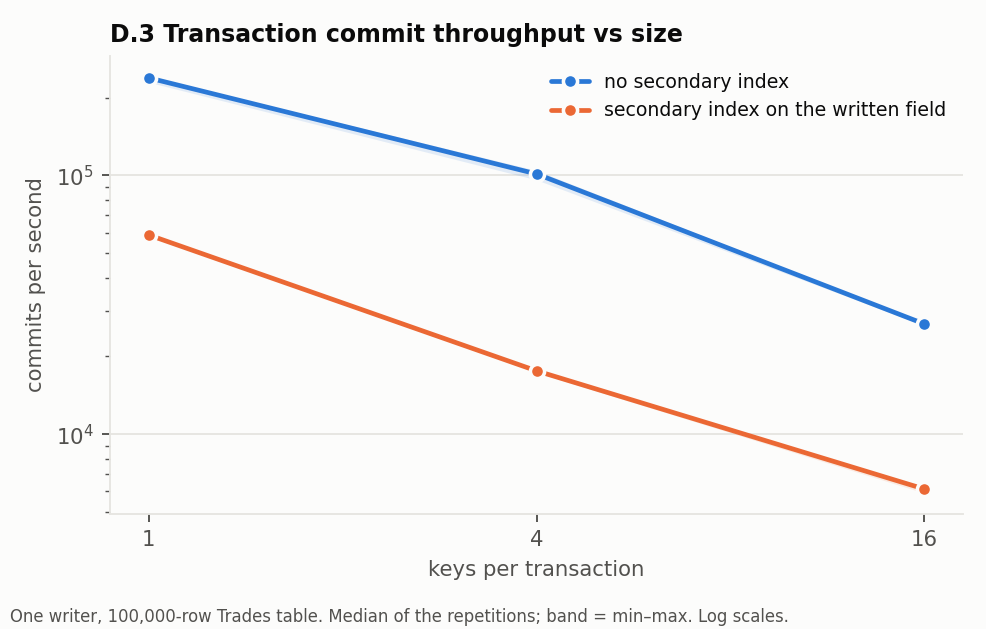{width=49%} 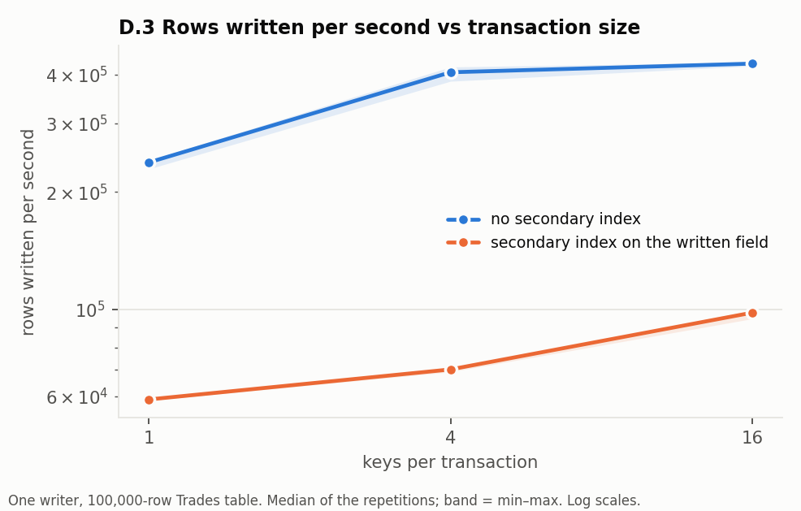{width=49%}

- **Commit throughput falls almost in proportion to the transaction size**: 238,103 → 101,298
  → 26,655 commits/s for 1, 4, 16 keys, because each key lands in a different partition and
  each touched partition is one 24 KiB segment to copy. A commit costs about 24 KiB of copying
  per key plus a fixed 2 KiB directory and about 250 owner-count updates.
- **Rows per second rise** (238,103 → 405,192 → 426,486) because that fixed part and the single
  publication are shared by more rows; the gain is small since the per-key copy dominates.
- Each commit is still one publication, whatever its size.
- **A secondary index on the written field costs about a factor of four** (58,824 against
  238,103 commits/s for one key): changing a row's indexed value rebuilds two of the 64 index
  partitions, about 115 KiB. With 100,000 rows and only 50 distinct values those partitions
  hold whole posting lists of 2,000 keys. This is the cost of copying index segments; the table
  the assignment indexes (Instruments, 50 rows) pays almost nothing, and the writer rewrote it
  in whole-table transactions 2,552 times per second during the join runs.

## 4.3 Where copy-on-write helps little, or hurts

Measured: the same Trade rows written as one transaction and as single puts.

| Case | Publications | Elapsed ms | Rows/s | Segments cloned | Bytes copied | Bytes copied per row (payload 32) |
|---|---:|---:|---:|---:|---:|---:|
| 100,000 rows, one transaction | 1 | 13.40 [13.18–13.67] | 7,462,767 | 256 | 6.1 MB | 61 |
| 100,000 rows, single puts | 100,000 | 559.41 [556.82–560.87] | 178,759 | 100,000 | 2,610 MB | 26,103 |
| 4,096 rows over all partitions, one transaction | 1 | 0.90 [0.73–1.02] | 4,526,992 | 256 | 6.1 MB | 1,500 |
| 4,096 rows, single puts | 4,096 | 23.94 [23.59–24.25] | 171,083 | 4,096 | 107 MB | 26,069 |
| 16 rows, one transaction | 1 | 0.03 | 557,414 | 15 | 0.35 MB | 21,632 |
| 16 rows, single puts | 16 | 0.06 | 258,490 | 16 | 0.40 MB | 25,088 |

Copy-on-write copies a whole 24 KiB segment to change one 24-byte slot: **816 bytes copied per
byte of payload** for a single-key update. That is where it hurts:

1. **Small, frequent, scattered writes.** Every update pays the full segment; that is why the
   global-mutex store, which updates one slot in place, completes 2.98 million updates/s where
   the RCU store completes 167,456 (D.1, 1 reader, unthrottled), and why the cleaner cannot keep
   up at 8 readers (§2.5).
2. **A very large transaction that touches most of the table**, the assignment's example. It
   is efficient *per row* (61 bytes per row for 100,000 rows: the segments are copied once and
   filled completely), but: it copies the entire index (6.1 MB here, the whole table); the old
   and the new version coexist, so memory doubles until the old one is reclaimed, and stays
   doubled for as long as any reader or snapshot is in the old version; and it is one
   13 ms-long commit during which no other write can be published. For a table larger than the
   caches this is a full rewrite to make a change that an in-place store would make row by row.
3. **A medium transaction spread thinly** is the worst per row among the batched cases: 4,096
   rows over all 256 partitions copy the same 6.1 MB as 100,000 rows (1,500 bytes per row),
   because every partition is touched and each is copied whole whatever fraction of it
   changes.
4. **Workloads with long readers.** A join or any long-held snapshot keeps every version
   published during it alive (447 MiB during 13 ms joins here); a lock-based store has no such
   cost because it has no old versions.
5. **Indexes on low-cardinality fields of large tables** (§4.2).

Where it helps: reads never wait (p99.9 of 0.21–0.56 µs against 1.4–16 µs for the lock stores
at 8 readers), read throughput scales with cores, the writer is not starved by readers
(10,000 of 10,000 paced updates where the shared mutex delivers 1,582), and multi-row
consistency for a reader costs nothing extra.

# 5. Failed or inconclusive hypotheses

- **"A bigger batch gives higher read throughput and a longer worst-case stall."** Not
  observed (§3.2). The batch affects reclamation throughput and memory.
- **"Owner counts share cache lines with reader data and cause the read slowdown next to a
  writer" (R8).** Only weakly supported: reader loads that hit a remotely modified line exist
  but are 0.07 % of sampled loads (§2.5). The dominant coherence traffic is between the writer
  and the cleaner. The slowdown itself is real and its cause is not established beyond "the
  readers are stalled on memory"; no change was made to the store.
- **"The steady workload is steady."** It is not at 8 readers with an unthrottled writer
  (§2.5): the backlog grows throughout.

# 6. Limitations and threats to validity

- One machine, one compiler, a laptop with two kinds of cores; the battery was charging and
  the temperature rose during the campaign. Ranges are narrow, but thermal effects are not
  excluded.
- Five repetitions of 3–5 s windows. "Longest stall" is a maximum over about 100 million samples and
  is sensitive to a single preemption; it is reported per run (median and worst), not
  averaged.
- Throughput includes two clock reads per operation (about a third of the cycles of an
  uncontended read).
- perf stat counters are per process, not per thread; they cannot isolate the readers.
  Kernel frames in the flame graphs have no symbols (`kptr_restrict = 1`).
- The cleaner thread is not pinned.
- `perf c2c` samples loads; a sample count is evidence of where contention is, not a
  measurement of its cost.
- Track R has no concurrent writer by construction and an 80 % hit rate; it is a compatibility
  reference, not the D.1 measurement.
- The join uses one Snapshot per store (two handles): each table is consistent, the pair is
  not an atomic cross-store snapshot.
- RCU and the lock stores differ in storage and update strategy, not only in synchronization.
- With reclamation disabled the window is 1 s; its throughput is not directly comparable with
  the 3 s runs.

# 7. Raw data

| What | Where (under `results/part_d/`) |
|---|---|
| Machine, toolchain, build flags, executable hashes, prerequisites | `env/` |
| Conditions at 56 checkpoints | `conditions.log` |
| D.1 track C: one CSV row per run; copy-on-write and reclamation counters | `d1/concurrent/runs.csv`, `cow.csv` |
| Latency histograms, one per run (read and write series) | `d1/concurrent/hist/`, `d2/*/hist/`, `d3/*/hist/` |
| perf stat and peak RSS per run; command line and exit status per run | `*/perf_stat/`, `*/rss/`, `*/stdout/` |
| D.1 track R | `d1/reference/` |
| D.2 workloads A and B | `d2/steady/`, `d2/backlog/` |
| D.3 transactions, join, copy-on-write, generator paths | `d3/txn/`, `d3/join/`, `d3/cow/`, `d3/generator/` |
| Flame graphs (9 SVGs), folded stacks, compressed `perf script` output, commands | `perf/flamegraphs/` |
| perf c2c reports (4) | `perf/c2c/` |
| Summary tables, CSVs, profile regrouping | `summary/` |
| Figures (12) | `figures/` |

Reproduce: `scripts/run_part_d.sh check`, then `scripts/run_part_d.sh all` (about 40 minutes;
refuses to run without mains power, the `performance` governor, usable perf and an idle
machine), then `scripts/aggregate_part_d.py results/part_d` and
`scripts/part_d_profile_breakdown.py results/part_d`.
